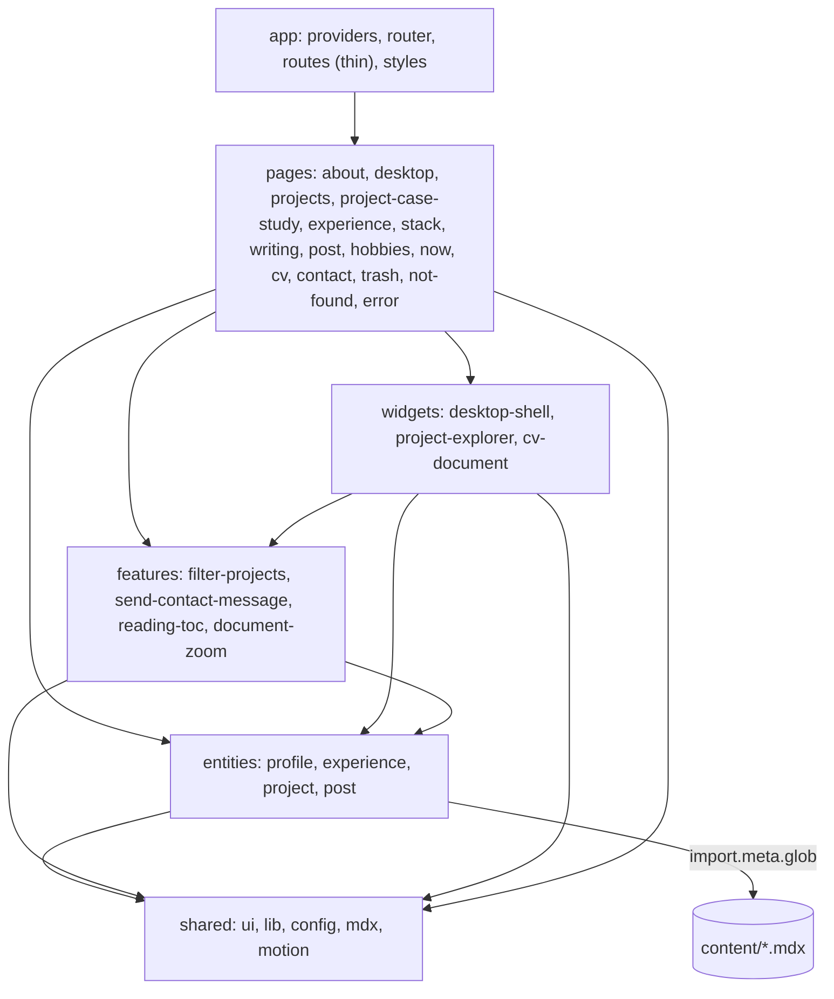
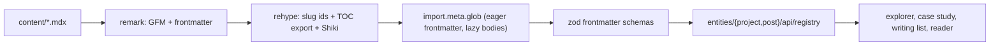
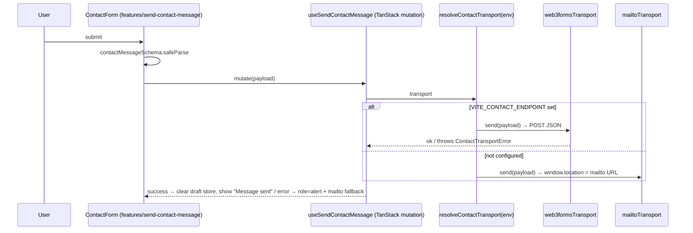

# Architecture

A personal site dressed as a desktop OS: a tiled wallpaper, icon rails and
one cream window per route, titled `~/igor/<file>`. The codebase doubles as a
showcase — Feature-Sliced Design with machine-enforced boundaries, typed and
validated static content, a ports-and-adapters contact transport, ADRs and a
full test pyramid.

## Layers

Rules (enforced by `pnpm lint:boundaries`, see [ADR 0001](adr/0001-feature-sliced-design.md)):
a layer imports only strictly below; slices never import each other;
cross-layer imports go through a slice's `index.ts`; `content/` is only
reachable from `entities/*/api/**`. The generated graph lives in
`docs/architecture/dependency-graph.mmd` (`pnpm deps:graph`).

## Route map

Every window is a route — the URL is the window manager ([ADR 0004](adr/0004-view-transitions-and-motion.md)).

| Route                      | Window title                    | Contents                                           |
| -------------------------- | ------------------------------- | -------------------------------------------------- |
| `/`                        | `about.md`                      | Hero + "Right now" aside                           |
| `/desktop`                 | —                               | The "all windows closed" sticky note               |
| `/projects`                | `projects/`                     | Explorer; filters + selection in URL search params |
| `/projects/$slug`          | `projects/<slug>/README.md`     | MDX case study (loader-loaded)                     |
| `/experience`              | `experience.md`                 | CV timeline + CV links                             |
| `/stack`                   | `uses.md`                       | The stack grid                                     |
| `/writing`                 | `writing/`                      | Post cards                                         |
| `/writing/$slug`           | `writing/<slug>.md`             | Reader with scroll-spy TOC                         |
| `/hobbies` `/now` `/trash` | `hobbies.md` `now.md` `.trash/` | Static copy                                        |
| `/cv`                      | `CV.pdf`                        | HTML rendition of the CV + zoom + PDF download     |
| `/contact`                 | `New message`                   | Compose form + elsewhere aside                     |
| unknown                    | `404.md` / `error.log`          | Not-found and error windows                        |

## Content pipeline

Registries throw `ContentError` naming the file on invalid frontmatter; slugs
derive from filenames; drafts never list. See [ADR 0002](adr/0002-static-content-mdx-zod.md).

## Contact transport

See [ADR 0003](adr/0003-contact-transport-adapters.md).

## State ownership

| State                        | Owner                                                 |
| ---------------------------- | ----------------------------------------------------- |
| Explorer filters + selection | URL search params (zod-validated, `.catch` fallbacks) |
| Contact mutation             | TanStack Query mutation                               |
| Contact draft                | Zustand, persisted to sessionStorage                  |
| CV zoom, clock, scroll-spy   | Local state / hooks                                   |

## Animation strategy

View Transitions animate the window swap (`view-transition-name: window`);
Motion (LazyMotion + domMax, `reducedMotion="user"`) handles gestures:
icon hover/tap and first-load stagger, list staggers, the sticky-note spring,
the `layoutId` selection pill, the contact success swap and title-bar drag
(desktop + motion allowed only — `data-draggable` is asserted in tests).

## Quality gates

`pnpm check` = typecheck + eslint + `lint:boundaries` + vitest.
`pnpm test:e2e` runs Playwright (desktop + mobile projects) including axe
(zero serious/critical) over the seven main routes. CI runs everything plus
`format:check` and the build.
